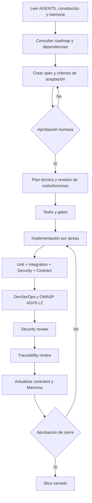

# AGENTS.md — PetMate Backend

> La fuente normativa única es `.specify/memory/constitution.md`. Este archivo define cómo trabajar; no debe duplicar la constitución.

## 1. Inicio obligatorio de cada sesión/tarea

Lee en este orden:

1. `AGENTS.md`.
2. `.specify/memory/constitution.md`.
3. `Memoria.md` (estado actual y decisiones).
4. `specs/README.md` (registro de Specs/Tasks y dependencias) y `specs/traceability.md` (matriz de trazabilidad).
5. El `spec.md` y el `task.md` del Spec `pm-NNN` que vas a trabajar (y su `plan.md` y `checklists/gates.md` si ya existen), más los Specs de los que depende. Los números de Spec no determinan el orden de trabajo: lo determinan las dependencias.
6. Los documentos canónicos enlazados por ese Spec, como `docs/api/endpoints.md` y `docs/security/asvs-l2-checklist.md`.

No asumas que la memoria está actualizada: comprueba estado del repositorio y contrástalo con evidencias.

## 2. Flujo operativo SDD

`spec → revisión/aprobación → plan → task → gates → implementación → pruebas → security review → traceability review → docs/memoria → aprobación humana`.

- No implementar una funcionalidad si su `spec.md` no está aprobado.
- No iniciar una tarea si no aparece en el `task.md` aprobado.
- No inventar requisitos para llenar huecos. Escribe una pregunta/decisión pendiente en el spec y detente en esa parte.
- Si el cambio afecta un contrato, rol, colección, endpoint, secreto, infraestructura o política de seguridad, actualiza primero el spec correspondiente.
- Un agente no aprueba ni firma su propio trabajo.

## 3. Convenciones del proyecto

- .NET 10 / ASP.NET Core 10.
- `src/PetMate.Api`: Web API MVC / Presentation.
- `src/PetMate.Application`, `Domain` e `Infrastructure`: Class Library.
- Clean Architecture, CQRS, Mediator e inyección de dependencias.
- Los controladores solo traducen HTTP a Commands/Queries y sus resultados a HTTP. No contienen reglas de negocio ni acceden directamente a MongoDB/Redis.
- MongoDB Atlas es el único proveedor de persistencia. Nunca iniciar MongoDB local ni sustituir Atlas en pruebas de integración.
- Redis de autenticación y Redis de caché son dos servicios separados.
- El despliegue es exclusivamente en Microsoft Azure con la suscripción Azure for Students (Constitución §8): dos o más instancias detrás de un Load Balancer o equivalente, HTTPS, CI/CD, IaC y observabilidad. No se crean recursos Azure reales ni se habilitan servicios con posibles cargos sin autorización expresa.
- Estructura SDD plana `specs/pm-NNN-slug/` (Constitución §12.3). La estructura anterior por slices está archivada y no se edita: `specs/_historico/`.
- Los endpoints de negocio utilizan ruta versionada y acción literal `/api/v1/{resource}/{action}`.
- Todas las respuestas usan `statusCode`, `message`, `data`; `data` puede ser `null` y `statusCode` debe coincidir con HTTP.
- Documentación en español; código en inglés; comentarios en español; mensajes API en español.

## 4. Costo y dependencias

Antes de agregar cualquier paquete, herramienta, agente, acción de CI o servicio cloud:

1. Verifica licencia y costo $0 para el uso previsto.
2. Verifica compatibilidad con .NET 10 y mantenimiento.
3. Comprueba vulnerabilidades conocidas.
4. Registra la selección y motivo en `plan.md` o decisión técnica.
5. Si tiene costo, licencia desconocida o excede cuota gratuita, no lo agregues; presenta alternativas $0.

No asumir que un producto sigue siendo gratuito por haberlo sido anteriormente. La selección de servicios Azure debe verificarse cuando se planifique el despliegue.

## 5. Secretos y configuración

- `.env` local está ignorado por Git y no se edita con credenciales reales dentro de documentación.
- `.env.example` contiene únicamente nombres y placeholders.
- Producción recibe secretos mediante configuración segura del entorno; nunca se despliega `.env`.
- No leer, imprimir ni copiar secretos durante una revisión. Si una tarea necesita comprobar una variable, informa solo si está configurada, nunca su valor.
- No almacenar tokens, contraseñas, URI sensibles ni PII en logs, fixtures, screenshots o `Memoria.md`.

## 6. Pruebas y verificación

Toda funcionalidad necesita pruebas unitarias, de integración y de seguridad; las pruebas de contrato/API deben añadirse cuando cambie un endpoint o el Response Wrapper.

- Integration tests: MongoDB Atlas base de pruebas independiente + servicios Redis no productivos.
- Nunca ejecutar escrituras destructivas sin comprobar el nombre de la base configurada.
- Verifica build Release antes de test cuando los comandos usen `--no-build`.
- No aceptar un pipeline verde si los escáneres están omitidos, deshabilitados o configurados para ignorar hallazgos sin aprobación.
- Registra comandos ejecutados, resultados, conteos y limitaciones en gates/memoria; no inventes resultados.

## 7. Agentes especializados

Usa los agentes de `.opencode/agents/` según la responsabilidad:

- `foundation-builder`: crea la solución vacía y su estructura técnica, siguiendo `00-foundation`.
- `feature-builder`: implementa las tareas autorizadas de una funcionalidad.
- `security-reviewer`: revisión independiente, solo lectura, sin corregir hallazgos.
- `traceability-reviewer`: compara spec ↔ plan ↔ tasks ↔ endpoints ↔ código ↔ tests, solo reporta.
- `documentation-keeper`: actualiza documentos Markdown permitidos, sin tocar código ni secretos.

Los agentes no sustituyen revisión humana ni cambian el alcance aprobado.

## 8. Memoria

Al cerrar cada tarea relevante, actualiza `Memoria.md` con estado, decisión, evidencia y riesgos pendientes. No copies el contenido entero de specs ni crees un historial de conversación. Si una observación se convierte en regla permanente, propone modificar la constitución en lugar de duplicarla en memoria.

## 9. Cierre de tarea

Una tarea solo puede marcarse `Verificado` cuando:

- El criterio de aceptación correspondiente está satisfecho.
- Los tests aplicables pasan.
- Los controles de seguridad aplicables pasan.
- No se introdujeron secretos, paquetes de pago ni servicios no aprobados.
- Se actualizaron contratos y documentación afectada.
- `checklists/gates.md` contiene evidencia reproducible.

El cierre de Spec queda pendiente de aprobación humana.
