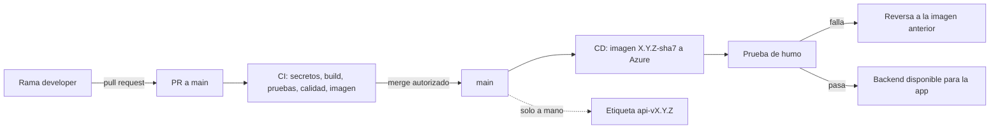

# Flujo de desarrollo para el equipo móvil (pm-167 / T185)

> Fija cómo la app móvil consume el backend mientras se desarrolla. No crea recursos ni cambia el pipeline: resume lo que ya existe en [pipeline.md](pipeline.md), [azure-deployment.md](../infrastructure/azure-deployment.md) y [version-matrix.md](../versioning/version-matrix.md), y los enlaza como fuente.

## 1. Flujo de cambios (pm-167#CA-01)

1. El trabajo vive en `developer` (o en ramas `feature/*` que se fusionan a ella). Cada pull request corre el CI completo hasta la imagen y **no despliega**.
2. Un merge a `main` dispara el mismo pipeline y, si la puerta de calidad y la imagen pasan, despliega: construye y escanea la imagen `X.Y.Z-<sha7>` (la `X.Y.Z` sale del archivo `VERSION`), crea una revisión nueva y ejecuta `scripts/smoke-test.sh` contra la URL desplegada.
3. **Reversa:** si la prueba de humo falla, el CD vuelve solo a la imagen anterior. A mano: `az containerapp update -n petmate-api -g rg-petmate-prod --image <imagen-anterior>` (ver [azure-deployment.md](../infrastructure/azure-deployment.md)).
4. **La etiqueta de versión `api-vX.Y.Z` no se crea con el merge**: solo a mano (*Run workflow* desde `main`, casilla `create_tag`) y tras un despliegue correcto (pm-059#CA-02).

## 2. Entorno compartido, estado y datos de prueba (pm-167#CA-02)

| Aspecto | Valor |
|---|---|
| Qué es | La demo en Azure Container Apps (`rg-petmate-prod`, región Chile Central, `ASPNETCORE_ENVIRONMENT=Production`), con Atlas `petmate_prod` y dos Redis. Es el único entorno compartido. |
| URL | `https://petmate-api.purplefield-b84659a6.chilecentral.azurecontainerapps.io` (declarada en [azure-deployment.md](../infrastructure/azure-deployment.md); cambia si se destruye y recrea el ambiente) |
| Estado verificado | **2026-11-17: `GET /api/v1/health/live` respondió 200.** No se verificó `health/ready`, la versión desplegada ni el resto de endpoints. El 2026-11-09 la misma URL no respondió, así que debe volver a comprobarse antes de depender de ella. |
| Modo ahorro | Si está activo (`MODO_AHORRO`), la API se apaga tras 15 minutos sin tráfico y la primera petición tarda ~10–20 s; Redis se apaga de 23:00 a 7:00. Un 503 en `health/ready` por la noche puede ser esto. |
| Contrato | OpenAPI y Scalar están **ocultos en Production**. El contrato de cada build es el artefacto `openapi` del job `contract-transversal` del CI (pm-166), y el catálogo humano es [endpoints.md](../api/endpoints.md). |
| Datos de prueba | **No hay datos sembrados ni cuentas compartidas.** Cada persona crea las suyas con `POST /api/v1/auth/register` y un correo propio (`...@example.com`); la prueba de humo hace lo mismo con correos aleatorios. Las cuentas se pueden borrar con `DELETE /api/v1/users/me/delete`. Nunca se usan datos personales reales. |
| Versión mínima | La app declara con qué versión mínima de la API funciona en su propio repositorio ([version-matrix.md](../versioning/version-matrix.md)). |

## 3. Autorización expresa (pm-167#CA-03)

Requieren **autorización expresa del usuario** (no basta con que el CI esté en verde ni con una aprobación anterior):

- **Crear, cambiar o destruir recursos de Azure** (Terraform *apply*, workflow *Infraestructura*, cambios de región, tamaño o servicios con costo).
- **Fusionar a `main`**, porque dispara el despliegue.
- **Crear la etiqueta de versión** `api-vX.Y.Z`.

Un agente o una persona sin esa autorización puede abrir pull requests, ejecutar el CI y proponer cambios, pero no ejecuta ninguna de las tres acciones.
