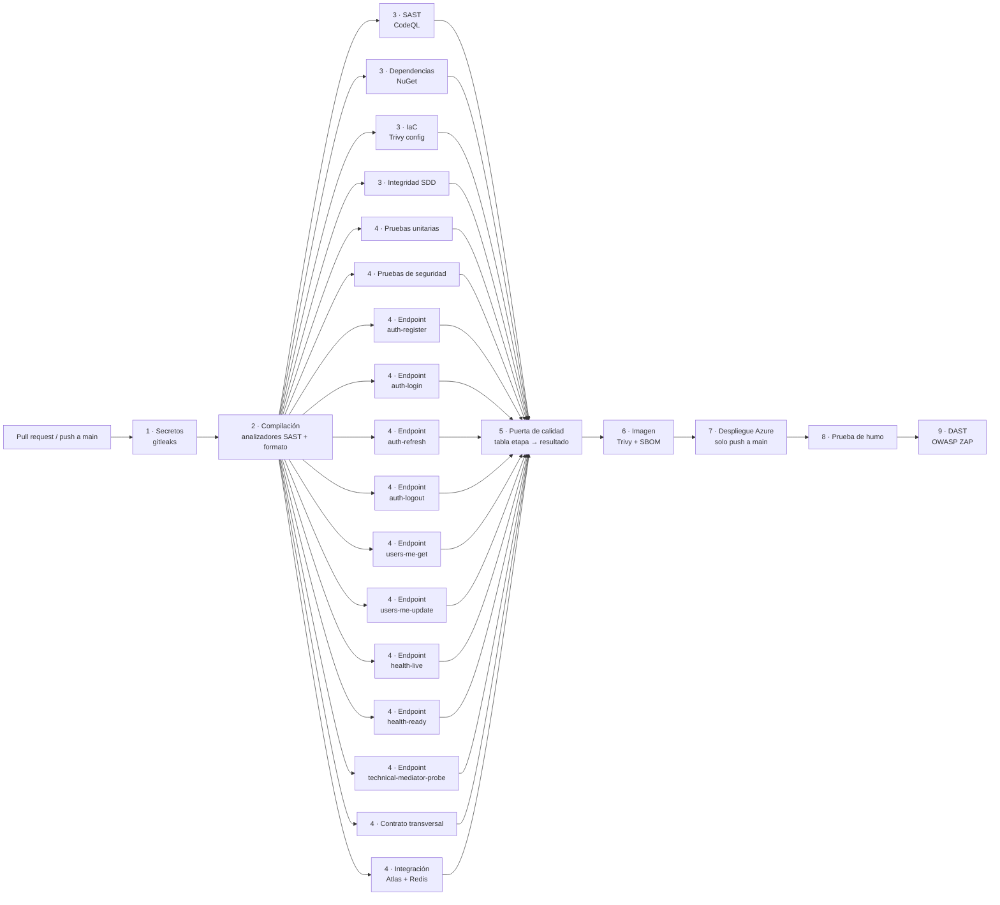

# Pipeline CI/CD DevSecOps

> Un solo workflow, `.github/workflows/pipeline.yml` («CI/CD DevSecOps»), muestra el flujo completo: el código pasa por secretos, compilación, SAST, dependencias, IaC, pruebas (cada endpoint en su propio job), puerta de calidad, imagen con escaneo, despliegue, prueba de humo y DAST. Todo se genera dentro del mismo run. Specs relacionados: pm-055, pm-057, pm-058, pm-059, pm-060, pm-077.

## Cuándo corre

| Evento | Qué hace |
|---|---|
| `pull_request` a `developer`, `release` o `main` | Corre todo hasta la imagen. **No despliega**: `deploy`, `smoke-test` y `dast` aparecen como *skipped* para que el diagrama del run muestre el flujo completo. |
| `push` a `main` (cambios en `src/`, `Dockerfile`, `Directory.*.props` o `VERSION`) | Corre todo y, si la puerta de calidad y la imagen pasan, despliega a Azure, ejecuta la prueba de humo y el DAST. |
| `workflow_dispatch` | Igual que el push; solo despliega si se lanza desde `main`. Acepta una versión SemVer opcional. |

Flujo de ramas: `feature/*` → `developer` → `release` → `main`. Los PR corren las mismas etapas de validación que `main`.

## Diagrama

Los nueve jobs `Endpoint · …` están en la misma columna (todos dependen solo de `build` y alimentan solo a la puerta de calidad). En un PR, las etapas 7, 8 y 9 se muestran omitidas.

## Etapas

| # | Job | Qué comprueba | Tipo | Falla el pipeline |
|---|---|---|---|---|
| 1 | `secrets-scan` | gitleaks sobre el repositorio y todo su historial (`.gitleaks.toml` con 5 falsos positivos revisados archivo por archivo). | DevSecOps | Sí |
| 2 | `build` | `dotnet restore`, `dotnet build -c Release -warnaserror` (analizadores de seguridad .NET como errores = SAST) y `dotnet format --verify-no-changes`. | DevSecOps | Sí |
| 3 | `sast` | CodeQL para C#; el SARIF queda como artefacto. | DevSecOps | No (informativo, ver límites) |
| 3 | `dependencies` | `scripts/quality-gate.ps1 -AuditOnly -MinSeverity High`: vulnerabilidades NuGet (High y Critical bloquean; las menores se muestran como advertencia), paquetes en desuso sin excepción aprobada y licencias fuera de la lista permitida. | DevSecOps | Sí |
| 3 | `iac-scan` | Trivy config (motor de reglas de tfsec) sobre `infra/`; HIGH y CRITICAL bloquean. Hoy: 0 hallazgos. | DevSecOps | Sí |
| 3 | `sdd-integrity` | `scripts/check-sdd.ps1`: Specs, Tasks, dependencias, trazabilidad y hashes de los documentos históricos. | Gobernanza SDD | Sí |
| 4 | `unit-tests` | Pruebas unitarias. | Pruebas | Sí |
| 4 | `security-tests` | JWT, autorización, rate limiting, configuración, detección de secretos en el código, manejo de errores. | DevSecOps | Sí |
| 4 | `endpoint-tests` (matriz de 9) | Un job por endpoint: `--filter "Endpoint=<valor>"` de ContractTests. | Pruebas | Sí |
| 4 | `contract-transversal` | Contrato que no es de un solo endpoint (wrapper, OpenAPI, autorización, superficie pública). | Pruebas | Sí |
| 4 | `integration-tests` | MongoDB Atlas de pruebas y dos Redis efímeros. Sin secretos de Atlas, esas pruebas quedan *Skipped* con aviso. | Pruebas | Sí (si una prueba falla) |
| 5 | `quality-gate` | Depende de todas las anteriores; escribe en el resumen una tabla etapa → resultado y falla si una etapa bloqueante no terminó bien. | Puerta | Sí |
| 6 | `docker-build` | Construye la imagen, Trivy de imagen (HIGH y CRITICAL bloquean) y SBOM SPDX con Syft. Nunca publica. | DevSecOps | Sí |
| 7 | `deploy` | OIDC a Azure, versión desde `VERSION`, imagen inmutable `X.Y.Z-<sha7>` (se reutiliza si ya existe), Trivy, publicación en ACR, nueva revisión de Container Apps, despertar la API, prueba de humo con reversa automática y etiqueta `api-vX.Y.Z`. | CD | Sí |
| 8 | `smoke-test` | `scripts/smoke-test.sh` contra la URL desplegada. | Verificación | Sí |
| 9 | `dast` | OWASP ZAP baseline (escaneo pasivo) contra la API desplegada. | DevSecOps | No (solo reporte) |

## Seguridad en cada etapa

| Etapa | Control |
|---|---|
| Código | gitleaks (secretos), analizadores .NET como errores, CodeQL |
| Dependencias | Auditoría NuGet de vulnerabilidades, desuso y licencias |
| Infraestructura | Trivy config sobre Terraform |
| Pruebas | Pruebas de seguridad, validación y 401/403 por endpoint, claims manipulados |
| Imagen | Trivy (HIGH/CRITICAL) y SBOM |
| Despliegue | OIDC (sin secretos de larga duración), imagen inmutable, reversa automática |
| Producción | Prueba de humo por HTTPS y DAST |

## Decisiones y límites

- **Sin `environment:` en el despliegue.** El plan gratuito de GitHub no permite environments en repositorios privados y cambiaría el subject de OIDC. La credencial federada de Azure solo confía en `refs/heads/main`; por eso el job `deploy` corre en push a `main` (o `workflow_dispatch` desde `main`).
- **Lógica de despliegue conservada.** Los pasos de `deploy` son los de `deploy.yml`. Se reconstruye la imagen en `deploy` porque necesita la CA pública de Redis que sale de Terraform; la imagen de la etapa 6 valida el Dockerfile y el escaneo antes de llegar ahí.
- **CodeQL es informativo.** El repositorio es privado y CodeQL publica alertas y se licencia solo con GitHub Advanced Security. Por eso el análisis corre con `upload: never` (SARIF como artefacto) y sus pasos tienen `continue-on-error`. El SAST que bloquea son los analizadores .NET de la etapa 2. **Decisión pendiente de Miguel:** si la licencia de CodeQL no está cubierta, crear la variable de repositorio `CODEQL_DISABLED=true` y el job se omite sin tocar el código.
- **IaC con Trivy en lugar de tfsec.** tfsec está integrado en Trivy (`trivy config`), que ya usa el pipeline; así no se añade otra herramienta. Hoy no hay hallazgos, por eso es bloqueante; si apareciera uno que no se pueda corregir, cambiar `exit-code` a `'0'` (soft-fail con SARIF) y registrarlo aquí.
- **Integración sin secretos.** Si `MONGODB_TEST_URI` / `MONGODB_TEST_DATABASE` no existen (por ejemplo, PR desde un fork), las pruebas contra Atlas se omiten con un aviso y el pipeline continúa. Las pruebas omitidas **no cuentan como aprobadas**: el resumen del job las muestra aparte.
- **Gitleaks por contenedor.** `gitleaks-action` exige licencia de pago en organizaciones; se usa la imagen oficial de código abierto fijada a la versión `v8.18.4`.
- **DAST informativo.** ZAP baseline no bloquea el pipeline; los hallazgos quedan en el informe `zap-baseline-report` y en el resumen.

## Secretos y variables que usa

Sin cambios respecto a antes. Secretos: `MONGODB_TEST_URI`, `MONGODB_TEST_DATABASE` (pruebas de integración). Variables: `AZURE_CLIENT_ID`, `AZURE_TENANT_ID`, `AZURE_SUBSCRIPTION_ID`, `TFSTATE_RESOURCE_GROUP`, `TFSTATE_STORAGE_ACCOUNT`. Opcional: `CODEQL_DISABLED`.

## Otros workflows

- `infra.yml` (Terraform, manual) y `atlas-ip-sync.yml` (cron) no forman parte de este pipeline.
