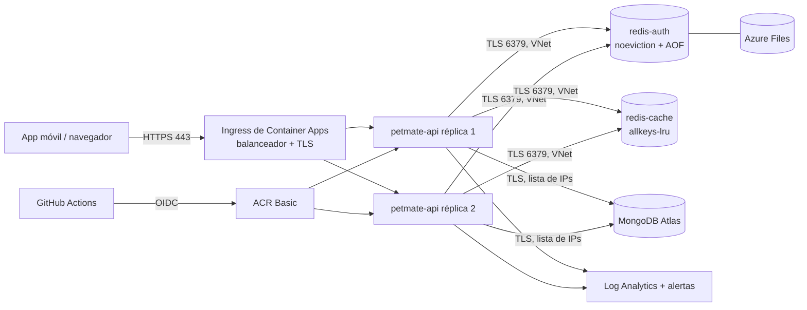

# Despliegue en Azure — primer despliegue del backend actual

> Alcance aprobado por el equipo (2026-11-05): publicar **exactamente el backend actual** (7 endpoints) con dos instancias, balanceo, HTTPS, Atlas, Redis Auth y Redis Cache, secretos, logs, CI/CD y Terraform. Sin endpoints nuevos, sin imágenes ni CDN.
> Decisiones: `docs/decisions/ADR-003-azure-container-apps.md` y `ADR-004-terraform.md`. Versiones: `docs/versioning/version-matrix.md`. Constitución §8 (v1.2.0 propuesta).

## 1. Arquitectura

Todo lo de la app vive en el grupo de recursos **`rg-petmate-prod`**. El estado de Terraform vive aparte en `rg-petmate-tfstate` para que la destrucción nunca lo borre.

## 2. Endpoints publicados (v0.1.0)

| Método | Ruta | Dependencias |
|---|---|---|
| POST | `/api/v1/auth/register` | Atlas, Argon2id, JWT |
| POST | `/api/v1/auth/login` | Atlas, Argon2id, JWT |
| POST | `/api/v1/auth/refresh` | Atlas, JWT |
| POST | `/api/v1/auth/logout` | Atlas, Redis Auth (lista negra), JWT |
| GET | `/api/v1/health/live` | ninguna |
| GET | `/api/v1/health/ready` | Atlas, Redis Auth, Redis Cache |
| GET | `/api/v1/technical/mediator-probe` | Mediator |

La URL pública queda como `https://petmate-api.<dominio-del-ambiente>.<region>.azurecontainerapps.io` (salida `api_url` de Terraform).

## 3. Configuración de producción (sin cambios de código)

| Variable | Origen | Valor |
|---|---|---|
| `ASPNETCORE_ENVIRONMENT` | Terraform | `Production` (no lee `.env`; OpenAPI/Scalar apagados) |
| `MONGODB_URI` | secreto GitHub `TF_MONGODB_URI` → secreto Container Apps | usuario de Atlas con `readWrite` solo en `petmate_prod` |
| `MONGODB_DATABASE` | Terraform | `petmate_prod` |
| `REDIS_AUTH_CONNECTION` / `REDIS_CACHE_CONNECTION` | generadas por Terraform | `redis-auth:6379,password=…,ssl=True,sslHost=redis-auth,abortConnect=False` |
| `JWT_ISSUER` | Terraform | `https://<fqdn de la API>` |
| `JWT_AUDIENCE` | Terraform | `petmate-api` |
| `JWT_SIGNING_KEY` | secreto GitHub `TF_JWT_SIGNING_KEY` | `openssl rand -base64 48` (nunca la del `.env`) |
| `TRUSTED_PROXIES` | variable GitHub `TRUSTED_PROXIES` | vacía hasta medir las IPs del ingress |
| `PETMATE_VERSION` | CD | versión SemVer desplegada |

Confianza en el TLS de Redis: el CD hornea el certificado público de la CA en la imagen (`--build-arg REDIS_CA_CERT_B64`, ver `Dockerfile`) y .NET lo usa desde el almacén del sistema. Compose y el desarrollo local no cambian.

## 4. Estudio de costos (pm-062)

Consulta: 2026-11-05. Precios de lista en USD; **confirmar en la calculadora de Azure** antes del primer `apply` y registrar el resultado aquí. Moneda de referencia de la constitución: MXN.

| Componente | Servicio | Clasificación (§8.2) | Estimado USD/mes | Fuente |
|---|---|---|---|---|
| 2 réplicas de la API (0.25 vCPU / 0.5 GiB) | Container Apps Consumption | crédito (tras la concesión gratuita de 180 000 vCPU-s y 360 000 GiB-s al mes) | ~9 | [Billing](https://learn.microsoft.com/azure/container-apps/billing), [Precios](https://azure.microsoft.com/pricing/details/container-apps/) |
| redis-auth y redis-cache (0.25 vCPU / 0.5 GiB c/u) | Container Apps Consumption | crédito | ~10 | idem |
| Balanceador, TLS y certificado | Ingress del ambiente | incluido | 0 | [Ingress](https://learn.microsoft.com/azure/container-apps/ingress-overview) |
| VNet y subred | Virtual Network | incluido | 0 | — |
| Registro de imágenes | ACR Basic (10 GiB incluidos) | crédito | ~5 | [ACR](https://azure.microsoft.com/pricing/details/container-registry/) |
| AOF de Redis Auth + estado de Terraform | Storage (Files 1 GiB, Blob) | crédito | < 1 | — |
| Logs y alertas por correo | Log Analytics (tope 0.15 GB/día), Azure Monitor | crédito / incluido | ~1 | — |
| Presupuesto | Cost Management | incluido | 0 | — |
| Base de datos | MongoDB Atlas M0 (externo) | incluido | 0 | — |
| CI/CD | GitHub Actions (repositorio privado, 2 000 min/mes gratis) | incluido | 0 | — |
| **Total** | | | **~26–28 USD/mes** (~1 USD/día) | |

- Crédito disponible: Azure for Students (USD 100 por 12 meses; sin tarjeta; al agotarse la suscripción se deshabilita, no genera cargos) — [FAQ](https://learn.microsoft.com/azure/education-hub/faq).
- El presupuesto de Terraform (USD 40/mes) avisa al 50, 80 y 100 %.
- **Sin conflicto académico:** la arquitectura completa (2 instancias + balanceador) cabe en el crédito; no se reduce ningún requisito (pm-062#CA-04).
- Descartados por costo: NAT Gateway (~33 USD/mes), Front Door (~35 USD/mes de base), Redis administrado ×2 con private endpoints.

## 5. Pasos hasta tener los 7 endpoints por HTTPS

1. **Herramientas** en la máquina de quien despliega: Azure CLI, Terraform ≥ 1.9, Git (`winget install Microsoft.AzureCLI Hashicorp.Terraform`).
2. **Verificar la suscripción** sin crear nada:
   `./infra/bootstrap/bootstrap.ps1 -SubscriptionId <id> -Location mexicocentral -CheckOnly`
   (regiones permitidas por la política de Azure for Students y disponibilidad de Container Apps).
3. **Bootstrap** (con autorización): mismo comando sin `-CheckOnly`. Crea `rg-petmate-prod`, `rg-petmate-tfstate`, la cuenta del estado y la identidad OIDC; imprime las variables de GitHub.
4. **Atlas**: crear la base `petmate_prod`, un usuario con `readWrite` solo en ella y una API key del proyecto (Project IP Access List Admin). Opcional: correr `scripts/mongo/petmate-db.mongodb.js`.
5. **GitHub** (Settings → Environments y Secrets): environments `production` (revisores obligatorios) y `atlas-sync`; variables y secretos que imprime el bootstrap; `TF_JWT_SIGNING_KEY` nueva.
6. **Plan**: Actions → *Infraestructura* → `plan`. Revisar con el equipo.
7. **Apply** (con autorización): Actions → *Infraestructura* → `apply`. Crea el ambiente, ACR, los dos Redis, la API (con imagen de arranque) y la lista de acceso de Atlas.
8. **Primera versión**: etiquetar `main` con `api-v0.1.0` → *Deploy API* construye, escanea, publica, despliega y ejecuta `scripts/smoke-test.sh`.
9. **Verificar** (pm-084): las 2 réplicas en el resumen del job; `ready` con `mongodb`, `redis-auth` y `redis-cache` en `Healthy`; logout revoca el token; HTTP redirige a HTTPS; reinicio de `redis-auth` sin perder revocaciones vigentes.
10. **Proxies**: en Log Analytics revisar la IP de origen que ve la API; si es estable, registrar `TRUSTED_PROXIES` y volver a aplicar.
11. Registrar la evidencia en `checklists/gates.md` de los specs y en `Memoria.md`.

## 6. Operación

- **Logs**: Log Analytics → tablas `ContainerAppConsoleLogs_CL` y `ContainerAppSystemLogs_CL` (filtrar por `ContainerAppName_s == "petmate-api"`).
- **Reversa**: el CD vuelve solo a la imagen anterior si falla la prueba de humo. A mano: `az containerapp update -n petmate-api -g rg-petmate-prod --image <imagen-anterior>`.
- **Destruir y recrear**: Actions → *Infraestructura* → `destroy` (escribir `destruir-petmate`). Atlas conserva sus datos; `apply` vuelve a crear todo.
- **IPs de Atlas**: *Sincronizar IPs de Atlas* corre cada 6 horas y a mano.

## 7. Riesgos conocidos

| Riesgo | Mitigación |
|---|---|
| La política de Azure for Students no permite la región o Container Apps | `bootstrap.ps1 -CheckOnly` antes de crear nada; cambiar `-Location` |
| El tenant escolar no deja registrar la aplicación OIDC | Pedir permiso al administrador o usar un service principal creado por quien tenga el rol; documentarlo |
| `TRUSTED_PROXIES` sin rango CIDR: el rate limit se agrupa por proxy | Medir IPs en el paso 10; si no son estables, spec de cambio para soportar CIDR (requiere aprobación) |
| Montaje de Azure Files restringido a la subred | Si el montaje falla, permitir el acceso del ambiente y documentarlo como excepción |
| Cambio de IPs de salida antes de la sincronización | Sincronización cada 6 h y manual; readiness lo refleja como `mongodb: Unhealthy` |
| HSTS no implementado (constitución §8.7) | Brecha registrada; requiere spec propio |
